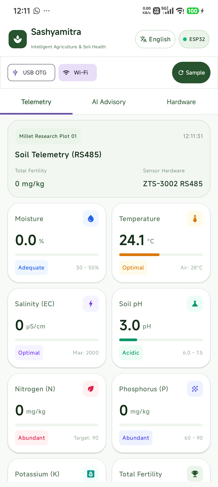

# 🌱 Sashyamitra (ସଶ୍ୟମିତ୍ର)

> **Next-Generation AIoT Smart Agriculture & Real-Time Soil Intelligence Platform**  
> Built for Indian farmers, precision agronomists, and soil researchers with multilingual regional support and zero-latency Modbus RTU telemetry.

[](https://github.com/blacksrj531/Sashyamitra)
[](https://github.com/blacksrj531/Sashyamitra)
[](https://github.com/blacksrj531/Sashyamitra)
[](https://github.com/blacksrj531/Sashyamitra)

---

## 📱 Live Production Preview

<div align="center">
  
  <p><i>Figure: Live telemetric dashboard displaying 7-in-1 soil dynamics in real-time.</i></p>
</div>

---

## 📦 Release Package & Binary Verification

The release APK is cryptographically signed and ready for immediate deployment on Android devices:

| Metric | Specification |
| :--- | :--- |
| **Package Name** | `sashyamitra.blacksrj.apps` |
| **Release File** | [`Sashyamitra-v1.0.0-release.apk`](./Sashyamitra-v1.0.0-release.apk) |
| **Version Code** | `1` (`1.0.0`) |
| **Binary Size** | `10.7 MB` (`11,234,375 bytes`) |
| **Min SDK / Target SDK** | Android 8.0 (API 26) / Android 15 (API 35) |

---

## 🎯 What We Engineered

Sashyamitra bridges complex industrial soil instrumentation with everyday farmers through seamless AI-assisted telemetry:

### 1. Industrial Modbus RTU Soil Gateway (ESP32)
* **Sensor Integration**: ZTS-3002-TR-ECTHNPKPH-N01 (RS485 Modbus RTU at 4800 baud, 8N1).
* **7-in-1 Soil Telemetry**:
  1. **Soil Moisture** (`0.0% - 100.0%`)
  2. **Soil Temperature** (`-40.0°C - +80.0°C`)
  3. **Electrical Conductivity / Salinity (EC)** (`0 - 20,000 µS/cm`)
  4. **Soil pH** (`3.0 - 10.0 pH`)
  5. **Available Nitrogen (N)** (`0 - 1,999 mg/kg`)
  6. **Available Phosphorus (P)** (`0 - 1,999 mg/kg`)
  7. **Available Potassium (K)** (`0 - 1,999 mg/kg`)
* **Real-Time Dynamic Zeroing**: Immediate detection when the sensor probe is pulled out of soil into air or disconnected, eliminating stale cached measurements.
* **Dual Local Streaming**: Dual Wi-Fi SoftAP REST endpoint (`http://192.168.4.1/api/data`) alongside high-speed USB Serial output (`115200 baud`).

### 2. High-Performance Android Native App (Jetpack Compose)
* **Zero-Permission Auto-Detection**: Engineered with Android `ConnectivityManager` process-network binding (`bindProcessToNetwork`). HTTP telemetry packets bypass cellular data (`5G/VoNR`) and bind directly to the ESP32 Wi-Fi interface without requiring manual mobile data toggling.
* **Deep Multilingual Localization**: Built-in support for 10 regional Indian languages with native agricultural terminology:
  - **Odia** (ଓଡ଼ିଆ)
  - **Hindi** (हिन्दी)
  - **Bengali** (বাংলা)
  - **Telugu** (తెలుగు)
  - **Tamil** (தமிழ்)
  - **Kannada** (ಕನ್ನಡ)
  - **Marathi** (मराठी)
  - **Gujarati** (ગુજરાતી)
  - **Punjabi** (ਪੰਜਾਬੀ)
  - **English**
* **Dynamic Language Selection**: Beautiful launch dialog with real-time reactive buttons and Indic typography preservation.

### 3. Production Security & Hardening
* **CRC16 Modbus Verification**: Rejection of frame corruption, inductive spikes, and EMI interference using polynomial `0xA001`.
* **Stack Buffer Bounded Protection**: Safe bounded buffer ingestion preventing overflow exploits.
* **Cleartext Network Isolation**: Android `network_security_config.xml` strictly confines unencrypted HTTP communication to the gateway endpoint `192.168.4.1`.
* **Resource Leak Prevention**: OkHttpClient automatic socket closure (`.use`), managed coroutine lifecycle scopes, and thread-pool cleanup.

---

## ⚡ Quick Installation Guide

### Option A: Direct APK Install on Phone
1. Download [`Sashyamitra-v1.0.0-release.apk`](./Sashyamitra-v1.0.0-release.apk) onto your Android phone.
2. Open the downloaded file in your file manager and tap **Install**.
3. Launch **Sashyamitra** and select your regional language.

### Option B: Install via ADB (Developer Mode)
```bash
adb install -r Sashyamitra-v1.0.0-release.apk
```

---

## 🔌 Hardware Wiring Reference

| Sensor Wire | Signal | Module / ESP32 Connection |
| :--- | :--- | :--- |
| **Brown** | Power VCC (`9V - 24V DC`) | External 12V/24V Power Supply (`+`) |
| **Black** | Power GND | External Power Supply (`-`) & ESP32 `GND` (Common Ground) |
| **Yellow** | RS485 `A+` | TTL-to-RS485 Module `A` Terminal |
| **Blue** | RS485 `B-` | TTL-to-RS485 Module `B` Terminal |
| **Module RXD** | Serial Input | ESP32 `GPIO 17` (TX2) |
| **Module TXD** | Serial Output | ESP32 `GPIO 16` (RX2) |
| **Module VCC/GND**| Logic Power | ESP32 `3.3V` / `5V` & `GND` |

---

## 👨‍💻 Author & Maintainer

* **Developer**: Soumya Ranjan Jena ([@blacksrj531](https://github.com/blacksrj531))  
* **Organization**: Sasyasathi / Sashyamitra AIoT Research  
* **Repository**: [https://github.com/blacksrj531/Sashyamitra](https://github.com/blacksrj531/Sashyamitra)
